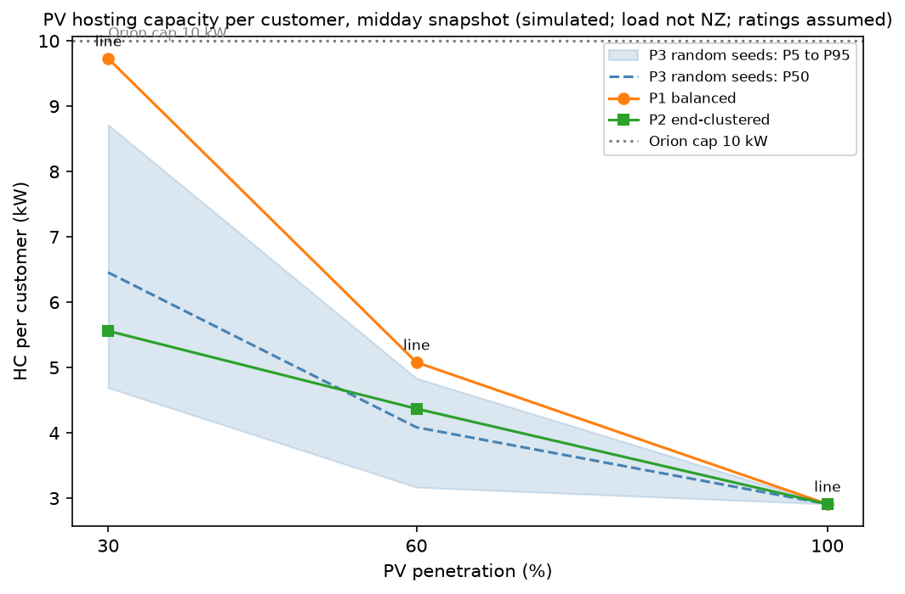
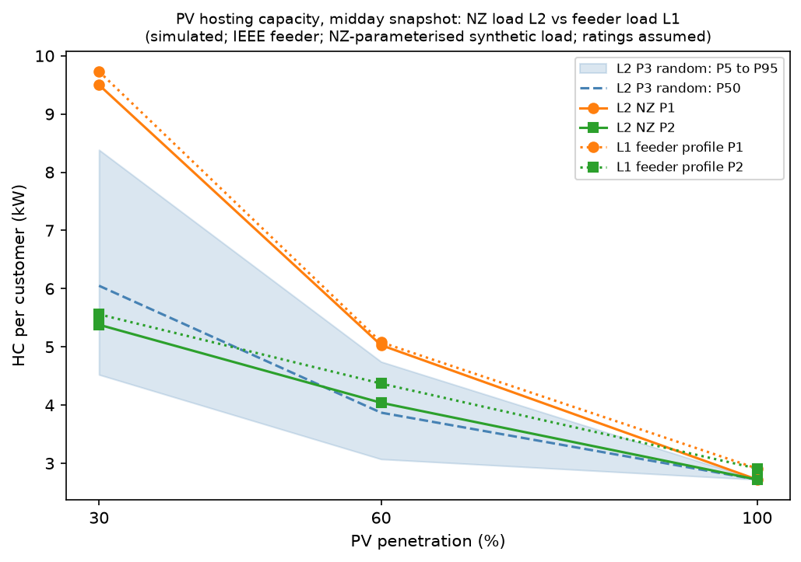
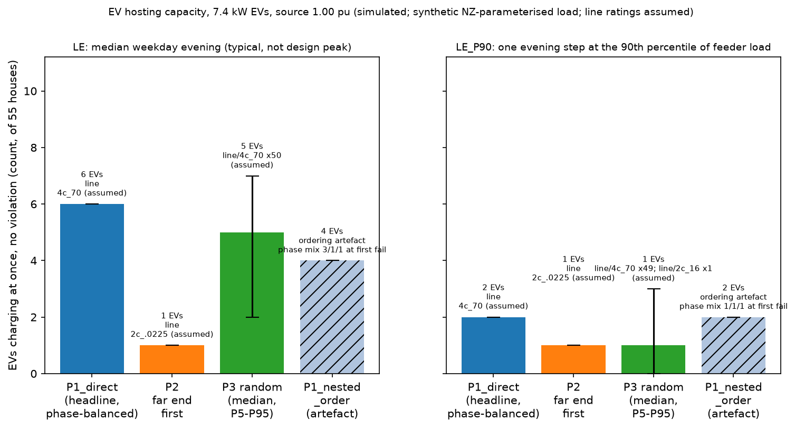
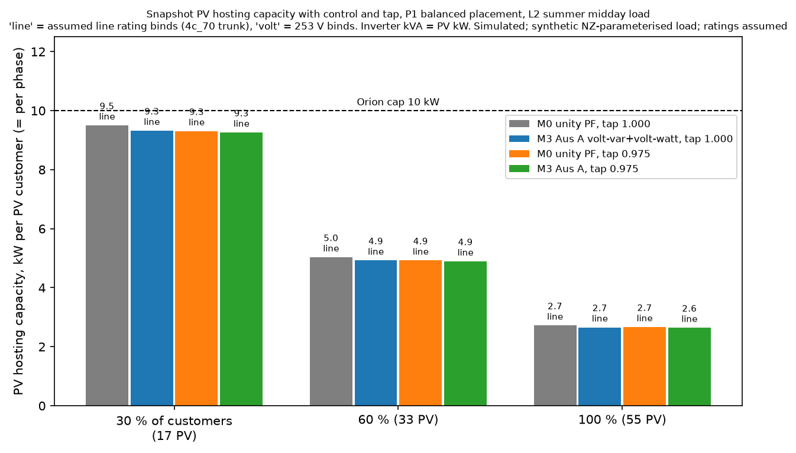
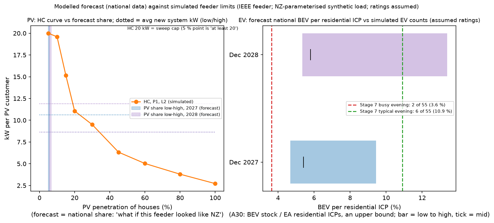

# PV + EV hosting capacity on a low-voltage feeder (OpenDSS + Python)

**Everything here is simulated. The load and EV data are synthetic (NZ-parameterised), PV is modelled, and the cable current ratings are assumed, not taken from a network owner. Nothing is measured, and nothing was compared with a real feeder.**

How much rooftop solar and how many EV chargers can an NZ-style low-voltage street take before a voltage or cable limit is broken? I designed and directed this project to answer that with the IEEE European LV Test Feeder (55 customers, 907 buses) in OpenDSS, driven from Python.

- It finds the largest solar size per house ("hosting capacity") with an Orion-style midday snapshot.
- It runs a whole year at 30-minute steps to count violation hours.
- It tests EV charging, Australia A inverter settings and a transformer tap.
- It checks its own maths against hand calculations and a published solution, and it lists what it cannot tell you.
- Author: Aniket Bailwal, Electrical and Electronic Engineering student, University of Auckland.
- Website with the results, the checks and the limits: https://abai936.github.io/pv-ev-hosting-capacity/

## Results at a glance

All numbers are simulated. "Assumed rating" means the feeder file has no cable current ratings, so I took them from datasheets by cable size. Each number links to the file it came from.

### 1. Solar: the cable heating limit binds before voltage

- With evenly spread solar, each solar house can export 9.5 / 5.0 / 2.7 kW when 30 / 60 / 100% of houses have solar ([stage8_summary.md](results/stage8_summary.md)).
- With randomly placed solar at 60% of houses the middle 90% range is 3.1 / 3.9 / 4.7 kW (5th, 50th, 95th percentile) ([stage6_snapshot_summary.md](results/stage6_snapshot_summary.md)).
- The binding limit is the assumed rating of the trunk cable next to the transformer. Voltage alone would allow 6.0 kW at 60% ([stage6_snapshot_summary.md](results/stage6_snapshot_summary.md)).
- The source voltage is a big assumption. At 1.05 pu the 60% result falls to 0.9 kW ([stage6_snapshot_summary.md](results/stage6_snapshot_summary.md)).
- Over a year, with 60% of houses on solar, 5 kWp per house gives 4.5 customer-hours above 253 V, and 8 kWp gives 1,330 customer-hours ([stage6_year.csv](results/stage6_year.csv)).
- Even with no solar, a cable rating (mostly the trunk) is exceeded for 141.5 hours a year, so thermal results are relative, not absolute ([stage6_year.csv](results/stage6_year.csv)).

### 2. EV charging: heat in the cables, not low voltage

- On a typical winter weekday evening, 6 of 55 houses can charge a 7.4 kW EV at the same time with balanced placement ([stage7_summary.md](results/stage7_summary.md)).
- On one busy evening it is 2 of 55 (3.6 %) ([stage7_summary.md](results/stage7_summary.md)).
- With random placement the count is 2/5/7 (5th, 50th, 95th percentile of 50 orders) ([stage7_summary.md](results/stage7_summary.md)).
- This count depends on the assumed trunk rating (see [LIMITATIONS.md](LIMITATIONS.md), item 3).

### 3. Mitigation: inverter settings fix voltage, not the cable limit

- Australia A inverter settings cut the year's time above 253 V from 1330.0 to 38.5 customer-hours (8 kWp on 60% of houses) ([stage8_summary.md](results/stage8_summary.md)).
- They do not raise the snapshot hosting capacity: 9.3 / 4.9 / 2.7 kW with control against 9.5 / 5.0 / 2.7 kW without ([stage8_summary.md](results/stage8_summary.md)).
- The cost is cable and transformer load. Hours with any line above its assumed rating go from 326.5 to 582.5, and the transformer peak from 195.1 to 216.6 kVA ([stage8_summary.md](results/stage8_summary.md)).
- Volt-watt alone barely helps: 1,302 customer-hours above 253 V and 48.3 kWh curtailed ([stage8_summary.md](results/stage8_summary.md)).
- A 2.5% lower transformer tap helps clustered solar (5.4 to 7.5 kW at 30%) but cuts evening EV voltage margin: lowest voltage with no EVs goes from 233.25 V to 227.08 V ([stage8_summary.md](results/stage8_summary.md)).

### 4. Uptake: what if this feeder looked like NZ in 2027 and 2028?

- These are modelled forecasts from national data (Electricity Authority, Ministry of Transport via Figure.NZ). They are not measurements and not predictions for this feeder.
- A simple "last year's trend" model beat the S-curve and the driver models in my back-test (mean error in percentage points of share: PV 0.13, EV 0.92) ([stage9b_summary.md](results/stage9b_summary.md)).
- The 80% forecast ranges are too narrow: they held the truth only 40 % (PV) / 27 % (EV) of the time ([stage9b_summary.md](results/stage9b_summary.md)).
- Solar share of houses, low / mid / high, Dec 2027: 5.0/5.1/5.6 %. Average new system: 8.6/9.0/10.6 kW ([stage9b_summary.md](results/stage9b_summary.md)).
- With 4 solar houses of 55 the simulated hosting capacity is 18.5 kW per house, above the average new system. A system of today's size first exceeds the limit at about 34 % penetration ([stage9b_summary.md](results/stage9b_summary.md)).
- EVs per residential connection, Dec 2027: 4.7/5.4/9.4 % (an upper bound). That reaches the feeder's simulated EV limits sooner than solar does ([stage9b_summary.md](results/stage9b_summary.md)).

## How this was built

I designed and directed this using generative AI tools: the code was written with AI coding assistants, and every result went through tests and an independent review. I am still working through the hand checks myself.

## What the project contains

- **Feeder.** The IEEE European LV Test Feeder in OpenDSS. I kept its impedances and its 11 / 0.416 kV ratio, and set the voltage bases so that 1 pu = 230 V.
- **NZ data chain.** Synthetic NZ-parameterised house load and EV sessions (Steidl et al. 2025), modelled PV (PVGIS), and the NZ limit of 207 to 253 V.
- **Hosting-capacity search.** A bisection search for the largest solar size per customer that breaks no limit, for balanced, end-clustered and random placement.
- **Year simulation.** 17,520 half-hour steps for 2022, counting violation hours and energy.
- **EV hosting capacity.** How many 7.4 kW chargers can run at once, snapshot and year.
- **Inverter control and tap.** AS/NZS 4777.2 Australia A volt-var and volt-watt, and a transformer tap setting.
- **Validation.** Hand calculations as tests, a published-solution benchmark, and a list of weak spots.
- **Uptake scenarios.** Back-tested forecasts of NZ solar and EV share for 2027 and 2028, read against the feeder limits.
- **Dashboard.** A plain Streamlit page that shows the saved results. It does not run OpenDSS.

## How to run it in 10 minutes

Windows commands are shown; on Linux or macOS use `.venv/bin/python`.

1. Clone the repo and open a terminal in its folder.
2. Make a virtual environment and install the pinned packages:
   `python -m venv .venv`, then `.venv\Scripts\python -m pip install -r requirements.txt`.
3. Download the feeder files (they are not in the repo): `.venv\Scripts\python scripts\download_data.py`.
4. Run the fast tests: `.venv\Scripts\python -m pytest -q -m "not slow"`.
5. Start the dashboard: `.venv\Scripts\streamlit run app\app.py`.

What is skipped without the big download: the NZ profiles are built from the Steidl dataset (Zenodo 15362256, a 989 MB zip, CC BY 4.0) and from PVGIS hourly solar data. Put them in `data/raw/` (links in [DATA.md](DATA.md)) and run `scripts\stage5_build_profiles.py`. That writes `data/processed/`, which stages 5 and later need. Without it, tests that need that data are skipped (not failed), and the committed result files in `results/` still show every number above.

`scripts/clean_clone_check.py` does steps 1 to 4 in a fresh clone and prints PASS or FAIL.

## Method in 10 lines

1. Hosting capacity is Orion-style: kW per customer on one phase, for a stated share of houses with solar.
2. The snapshot is a midday summer weekday with each house's median load.
3. A solar size passes only if every customer stays within 207 to 253 V, no cable or the 800 kVA transformer is above its (assumed) rating, and voltage unbalance stays under an assumed 2%.
4. A bisection search finds the largest passing size to 0.01 kW.
5. The source voltage is 1.00 pu in the base case and is swept as an assumption (the original file uses 1.05 pu, which is already over 253 V with no solar).
6. A neutral-return correction is applied to the single-phase service cables (about 0.5 V), checked by hand against a loop formula.
7. Inverters follow AS/NZS 4777.2 Australia A curves taken from free summaries, not the paywalled standard.
8. Inverter control is solved repeatedly from a fixed cold start, so a result never depends on the previous point.
9. The year run uses 30-minute steps, with load, PV and EV profiles for 2022.
10. Every result file carries a label that says it is simulated.

## Validation

- Toy circuits match hand calculations to 4 decimal places, and the 907-bus feeder matches the published OpenDSS solution to 0.003 V (worst case, with constant-power loads).
- Hand checks of voltage rise (5 kW at the far-end house: 4.787 V predicted, 4.787 V in OpenDSS) and EV current agree to within 0.03%, but they share a helper with the model, so they are not fully independent.
- Energy balances only prove signs and units. Nothing is compared with measured data. See [VALIDATION.md](VALIDATION.md) for all 32 rows and the weak spots.

## Limitations (the five biggest)

1. **Simulation only.** No hardware, no measured feeder data.
2. **Cable ratings are assumed.** The thermal limit binds in almost every case, so most headline hosting-capacity numbers rest on an unchecked input. A 5% change in the assumed rating moved the EV count from 6 to 9.
3. **Synthetic load.** Every house is statistically identical, so heavy-user and light-user homes are missing. This tends to make results look better than reality.
4. **30-minute steps** average away short peaks, so violation hours are too low.
5. **One feeder.** Results say nothing certain about other networks.

The full list, with the direction of each bias, is in [LIMITATIONS.md](LIMITATIONS.md).

## Repo layout

- `src/hc/`: the model code (feeder, hosting search, inverter, year run, EV, mitigation, uptake).
- `scripts/`: one script per stage, plus `download_data.py` and `clean_clone_check.py`.
- `tests/`: pytest tests, including the hand calculations.
- `results/`: result CSVs and summaries (all simulated).
- `checkpoints/`: one short report per stage, with figures (`checkpoints/img/`).
- `app/`: the Streamlit dashboard.
- `data/`: `line_ratings.csv` only. Downloaded data is git-ignored.
- `research/`: sourced research notes. `ASSUMPTIONS.md`, `VALIDATION.md`, `LIMITATIONS.md`, `DATA.md`: the honesty files.

## Data and licences

See [DATA.md](DATA.md). The IEEE feeder files are **not included**: no licence is stated, so `scripts/download_data.py` fetches them from the public source. The Steidl dataset is CC BY 4.0. PVGIS, Electricity Authority, Ministry of Transport (via Figure.NZ), MBIE and Stats NZ data are used under the terms recorded in [DATA.md](DATA.md) and [research/R11-uptake-data.md](research/R11-uptake-data.md); where a licence was not checked, those files say so.

## Status

Version 0.9. Simulation only. The engineering stages are built and tested, and the results website is live (link above). Next steps: a better source for the cable ratings, a rating sweep around the assumed value, and a second feeder.

## Licence

My code is under the MIT licence (see [LICENSE](LICENSE)). The data keep their own terms.
