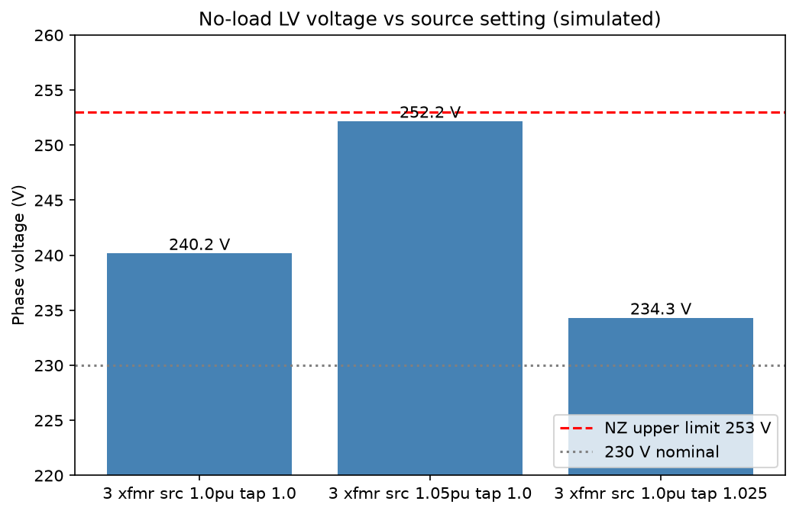
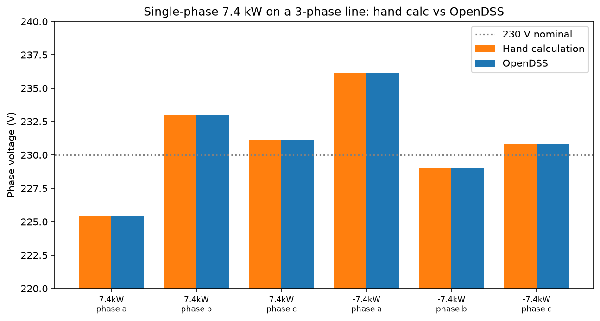

# CP-02: Stage 2, hand-checked toy circuits (19 Nov 2026)

All numbers are **simulated** (OpenDSS) and checked against independent hand calculations written in plain Python. Source: `results/stage2_toy_checks.csv`.

## Figures

At no load, the feeder's 11/0.416 kV transformer gives 240.2 V per phase at source 1.00 pu. At the original 1.05 pu it gives 252.2 V, only 0.8 V under the NZ 253 V limit. Raising the primary tap to 1.025 lowers it to 234.3 V.

One 7.4 kW single-phase load drops its own phase to 225.5 V, and the two unloaded phases rise to 233.0 V and 231.1 V. With 7.4 kW of PV export instead, the PV phase rises to 236.1 V and the others fall. The hand calculation (orange) and OpenDSS (blue) agree to 4 decimal places.

## Done
- `src/hc/toy.py` builds four small circuits. `tests/test_stage2_toy.py` checks each against a hand calculation, with tolerances of 0.5%, 0.2% and 0.1%.
- `scripts/make_figures.py` draws the checkpoint figures from the results CSVs.

## Works (checked)
- `pytest tests/test_stage2_toy.py`: **7 passed**.
- The hand-calculation functions make no OpenDSS calls (checked by the reviewer). So the exact match is real, not copied.
- The IEEE 13-bus solves; min 0.9608 pu and max 1.0560 pu, the same as R1.

## Failed or found
- **Load model trap.** OpenDSS loads switch to constant impedance above 1.05 pu of their rated kV. For these loads that is 241.5 V, which is inside our study range. It gave a 3.3% error until it was fixed. Every real-feeder load now has vmaxpu = 1.3.
- **The "12.45 V" rise from research R6 doesn't fit our circuit.** R6 held the receiving end at 400 V; our test holds the source at 415 V. With the source fixed, the exact rise is 11.68 V, and OpenDSS agrees. The simple estimate R·P/V gives 12.5 V.
- **The CSV was once left with only 6 rows,** after a partial test run. Running the full file regenerates it. Note: only run the full file before making figures.
- **Not yet reviewed by the reviewer.** It is batched with Stage 3.

## Next
Stage 3a is running: the real 907-bus feeder on the NZ voltage base, a benchmark against the published IEEE results, a day at 4 source voltages, and an InvControl speed test.

