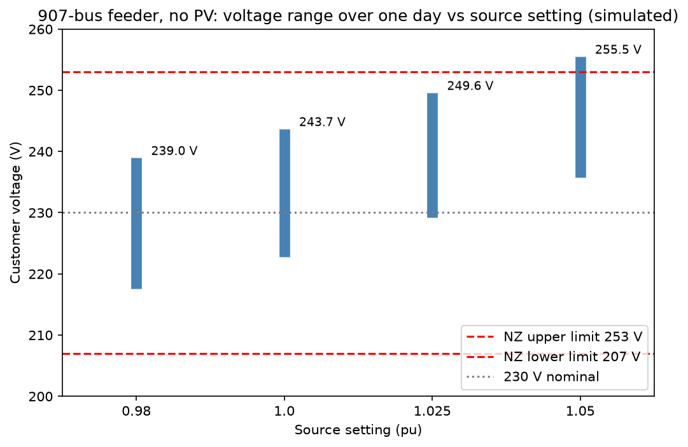
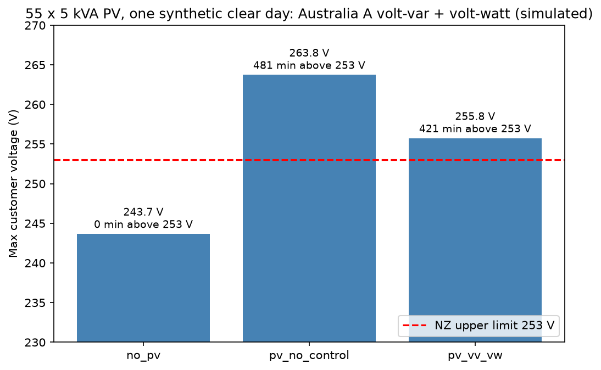

# CP-03: Stage 3, the 907-bus LV feeder base case (19 Nov 2026)

Everything here is **simulated** on the IEEE European LV feeder. Load is the feeder's own 1-minute profiles. PV is a synthetic clear-sky day. Results are in `results/stage3_*.csv`.

## Figures

With no PV, the feeder stays inside 207 to 253 V at source 1.00 pu (222.8 to 243.7 V). At the original 1.05 pu it goes above 253 V for 51 minutes of the day.

PV of 5 kVA at all 55 houses pushes the worst bus to 263.8 V. Australia A volt-var plus volt-watt brings that down to 255.8 V, but 421 minutes stay above 253 V. Volt-watt starts at 253 V, so it reduces overvoltage but does not prevent it.

## Done
- `src/hc/feeder.py`: NZ voltage base, source setting, constant-power loads, customer voltages, transformer kVA, VUF and line loading.
- `src/hc/inverter.py`: Australia A curves with flat ends.
- `src/hc/neutral.py`: neutral-return correction for the service cables.
- `data/line_ratings.csv` and `research/R10`: line ratings, with each cable size matched by resistance against two cited datasheets.
- `ASSUMPTIONS.md`: every assumption with its bias direction.

## Works (checked)
- **pytest: 37 passed.**
- **Benchmark against the published IEEE results.** Max error 0.003 V against OpenDSS and 0.001 V against GridLAB-D, using constant-power loads. With the feeder's default load model the error is 0.40 V. So the published solution uses constant-power loads.
- **Cable match.** 6 of 10 linecodes match a datasheet cable to within 1.2% in resistance (for example, 4c_185 matches Al 185 mm²).
- **Volt-watt base.** It is S_rated: OpenDSS gave 2.997 kW against 3.0 kW expected, at 256.5 V with a DC:AC ratio of 1.2.
- **Neutral loop hand check.** Matches OpenDSS within 0.01%.
- **Speed.** Inverter control about doubles the time per step, to about 6 ms. A full year at 30-minute steps should take about 2 minutes [guessed].

## Failed or found
- **Reviewer found three issues; all are fixed:**
  - the curves kept going past their end points;
  - the benchmark was not run on the true original setup;
  - the volt-watt test was missing.
- **The service cables leave out the neutral return.** The effect is only about 0.5 to 0.8 V. The corrected model is now the base case, and the original is kept as a sensitivity.
- **Thermal may bind before voltage.** With no PV, the busiest line runs at 86% of its assumed rating. With 5 kVA PV at every house, the worst line reaches about 200%. Which line that is has not been checked yet; Stage 4 will report it.
- **Low-confidence ratings.** Two cable ratings (2c_.007, 4c_.35) are low confidence and probably optimistic.
- **Still running.** The Steidl download status is unknown (it is resuming in the background).

## Next
Stage 4: the first headline hosting-capacity number, done Orion-style as a midday snapshot.

