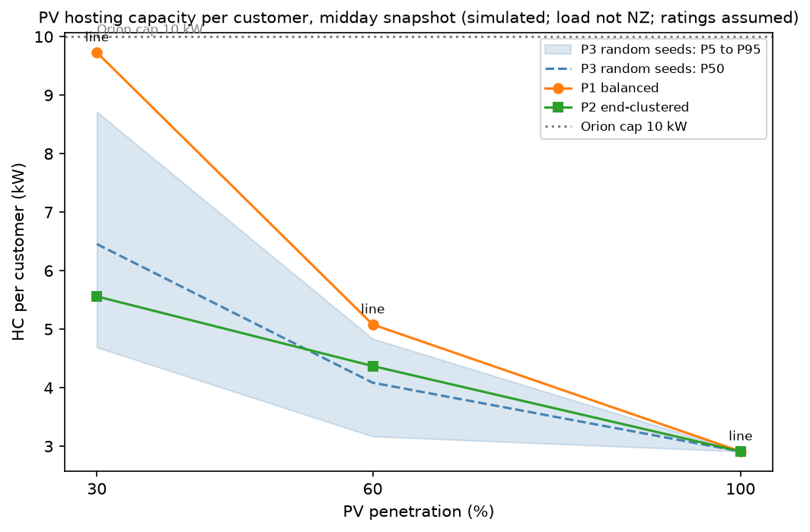
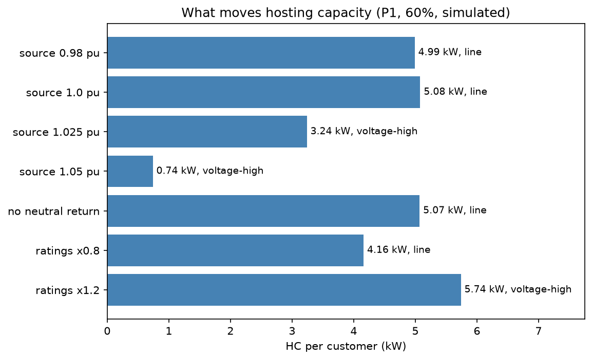

# CP-04: Stage 4, first PV hosting capacity, midday snapshot (19 Nov 2026)

**Simulated.** IEEE European LV feeder; load is the feeder's own (non-NZ) profile at 12:00 (L1) or zero load (L0); line ratings are assumed (R10). Reviewed by the reviewer and fixed. Sources: `results/stage4_hc.csv`, `results/stage4_summary.md`, `results/stage4_hand_check.csv`.

## Figures

Hosting capacity (HC) per customer falls as more houses have PV. Evenly spread PV (P1) gets the most. With every house exporting, all placements converge to 2.9 kW.

The source voltage matters most. At 60% penetration, 1.00 pu gives 5.1 kW per customer, but 1.05 pu gives only 0.7 kW.

## Results (source 1.00 pu, L1; kW per customer)
| Penetration (N houses) | P1 balanced | P2 end-clustered | P3 random, 50 seeds (P5 / P50 / P95) |
|---|---|---|---|
| 30% (17) | 9.7 | 5.6 | 4.7 / 6.5 / 8.7 |
| 60% (33) | 5.1 | 4.4 | 3.2 / 4.1 / 4.8 |
| 100% (55) | 2.9 | 2.9 | 2.9 |

- **Binding limit:** the 4c_70 trunk cable next to the transformer (line1), with an **assumed** 195 A rating, in every thermal case. Voltage above 253 V binds when PV is clustered or penetration is low.
- **Never binding:** the transformer (max 140 kVA of 800) and VUF (max 1.18% against the assumed 2%).
- **Zero load (L0)** gives a lower HC everywhere, for example 4.4 kW at 60% for P1.
- **Hand checks:**
  - 5 kW at the far-end house: predicted rise 4.787 V, OpenDSS 4.787 V (error −0.012%).
  - At 100% penetration: (195 A × 245 V + 12.8 kW local load) / 21 houses on that phase = 2.88 kW, the same as OpenDSS.

## Fixed after review
- "30%" was really 16 houses (Python rounds halves to even). It is now 17, and the count is stated.
- The binding element is now reported as the trunk chain, not a random line in it.
- 50 random seeds instead of 20. P2 is not the worst case: random placement can pile PV on one phase.
- The source sweep has a dip at 0.98 pu, which is explained: that case is thermal-bound, so lower voltage means more current.

## Next
Stage 6 re-runs this with **NZ summer-midday load** (the real headline). It also runs the full year at 30-minute steps.

