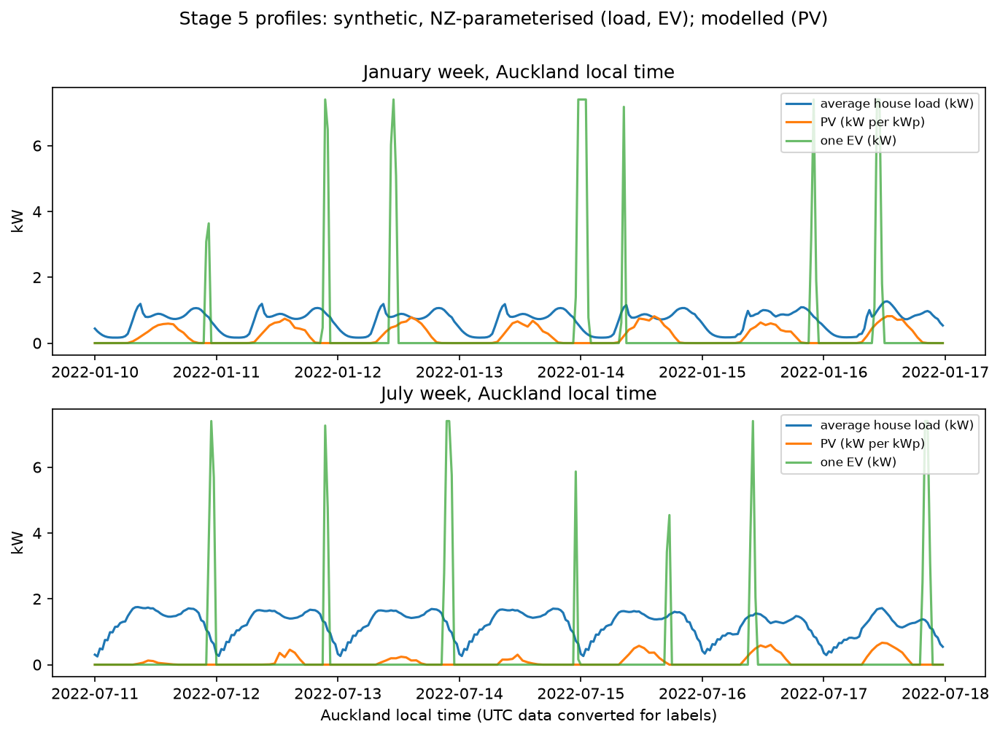

# CP-05: Stage 5, NZ-style load, PV and EV profiles for 2022 (19 Nov 2026)

**Synthetic, NZ-parameterised (load, EV); modelled (PV).** Not measured data. Sources and licences are in `DATA.md`; assumptions A13 to A19 are in `ASSUMPTIONS.md`.

## Figure

One January week and one July week, in Auckland local time: the average house load (blue), PV per kWp (orange) and one EV (green).

## Done
- **Load.**
  - Shape: the Steidl et al. 2025 resLoadSIM Auckland 2022 city load, minus EV, averaged to 30 minutes.
  - Scale: 7,048 kWh per house per year (MBIE via Figure.NZ, year ended March 2025, national).
  - House-to-house diversity: from the feeder's own 100 profiles.
  - The 55 houses average 7,167 kWh, with a range of 2,700 to 18,200 kWh.
- **PV.** PVGIS-ERA5 2022 hourly data for Auckland, 30° tilt, facing north, 14% losses.
- **EV.** Synthetic 7.4 kW single-phase sessions. Start times follow the EECA 2023 survey (34% start at 9 pm). Session size has a 6.9 kWh median (Vector trial, from a search snippet only, so not confirmed). That gives about 2,870 kWh per EV per year.

## Works (checked)
- **pytest: 49 passed.**
- **PV capacity factor.** 0.158, compared with EECA/AMCL's 0.151 for Auckland, north-facing at 30° (+4.3%). South-facing would give 0.090.
- **Time of day (checked by the reviewer on the processed files, in Auckland local time).** The January load peaks at 20:00. The July appliance load peaks at 19:00. PV peaks around 13:30.
- **EV.** The mean session is 7.86 kWh against 7.82 expected. The start-hour histogram matches the survey to within 2 points.

## Failed or found
- **Steidl timestamps are mislabelled.** The files say UTC, but the appliance load bottoms out at 03:00 and peaks at 19:00 by label in every month, with no shift when daylight saving changes. So the labels are NZ standard time, UTC+12 (A19). Taken as UTC, every peak would have moved by 12 hours.
- **The winter heating timing in Steidl looks wrong.** The July total load peaks at about 11:00 because of heating. The default shape keeps it; an appliances-only shape is kept as a sensitivity check.
- **PVGIS direction.** PVGIS measures aspect from south (0 = south), so north-facing is aspect 180. A test now guards this.
- **Two builder choices to note:**
  - The last 12 hours of the year are filled with the day before, because the time shift moves them into 2023.
  - An EV session waits for the same car's previous session to finish.

## Next
Stage 6: hosting capacity on the NZ summer-midday load (the headline), plus a full year at 30-minute steps.

