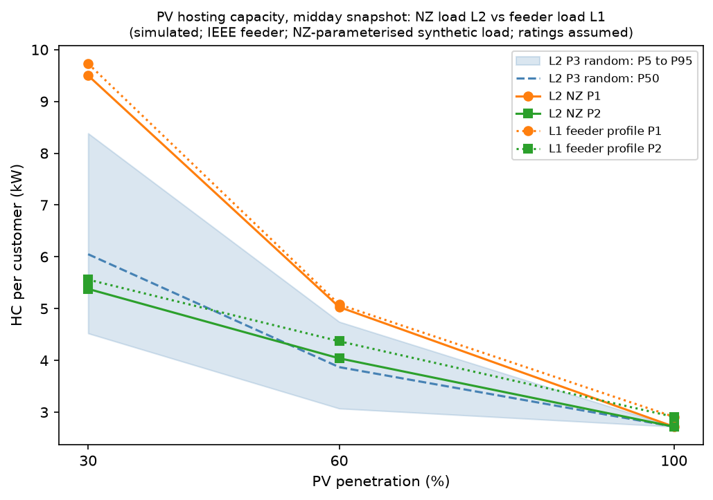
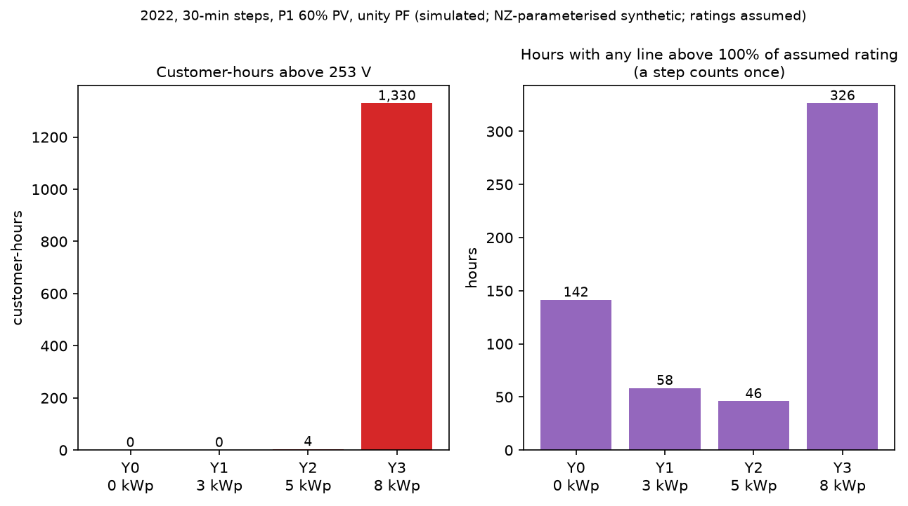

# CP-06: Stage 6, NZ headline hosting capacity and year time series (19 Nov 2026)

**Status: built, run, reviewed twice, fixed.** Everything is **simulated**: IEEE European LV feeder, NZ-parameterised synthetic load, modelled PV, assumed line ratings. Nothing is measured.
Sources: `results/stage6_snapshot_hc.csv`, `results/stage6_snapshot_summary.md`, `results/stage6_year.csv`, `results/stage6_year_seeds.csv`, `results/stage6_year_linecodes.csv`, the recorded pytest run.

## Figures

Hosting capacity (HC) per customer with NZ summer-midday load (L2) is about the same as, or slightly lower than, with the feeder's own one-minute profile (L1): 9.5 / 5.0 / 2.7 kW against 9.7 / 5.1 / 2.9 kW. [checked: from the CSV]

A whole year at 30-minute steps, PV at 60% of houses (evenly spread). Voltage stays within 253 V up to 3 kWp per house. At 5 kWp it breaks only 1 distinct hour (4.5 customer-hours). At 8 kWp customers spend 1,330 customer-hours (207.5 distinct hours) above 253 V. [checked: from the CSV]

## Done
- **6a, NZ midday snapshot (L2).** Each house's median load at 12:00 and 12:30 NZDT on 63 summer weekdays. P1, P2, P3 (50 seeds), the source-voltage sweep, L2b, and a **house-diversity seed sweep** (5 seeds).
- **6b, year 2022, 30-minute steps (17,520).** Y0 no PV; Y1, Y2, Y3 = 3, 5, 8 kWp at 33 houses (P1). Unity PF, no inverter control, no EV. Y0 also run for 5 diversity seeds.
- **Review and fixes.** The reviewer found that the no-PV trunk overloads came mostly from the load model, not from winter heating: each house reused one UK profile on all 365 days, so the same houses peaked together every day. Now each house picks one of 100 profiles per day (seeded; ASSUMPTIONS A20). Also fixed: a test that overwrote the processed data, the appliances-only (L2b) scaling, and "line-hours" being reported as if it were hours.

## Works (checked)
- **pytest, full suite: 61 passed (49.6 s)** (the recorded pytest run).
- **Energy balance** (load + losses − PV = transformer energy): worst error −0.0002%. 0 non-converged steps. This is a bookkeeping check (any converged power flow passes it). It proves signs and units, not that the model is right.
- **Headline snapshot (L2, source 1.00 pu, kW per customer):**

| Penetration (N) | P1 balanced | P2 end-clustered | P3 random, 50 seeds (P5 / P50 / P95) | Binding (P1) |
|---|---|---|---|---|
| 30% (17) | 9.5 | 5.4 | 4.5 / 6.0 / 8.4 | trunk 4c_70 (assumed rating) |
| 60% (33) | 5.0 | 4.0 | 3.1 / 3.9 / 4.7 | trunk 4c_70, phase 3 (assumed rating) |
| 100% (55) | 2.7 | 2.7 | 2.7 | trunk 4c_70, phase 1 (assumed rating) |

- **Diversity seeds (P1):** 9.5 to 9.6, 5.0 and 2.7 to 2.8 kW. The result hardly depends on the random house mix.
- **Voltage-only HC** (ignoring cable ratings) at 60%: 6.0 kW. So the cable rating, which is assumed, is what limits P1.
- **Source sweep** (P1, 60%): 0.98 pu gives 5.0 kW, 1.00 gives 5.0, 1.025 gives 3.5, 1.05 gives 0.9.
- **L2b** (no electric heating or hot water) gives the same HC as L2. At summer midday heating is about zero, so this was expected.
- **Year results (seed 2022):**

| Case | Max V | Customer-hours above 253 V | Distinct hours any line above 100% | Max line loading | Reverse-flow hours | Max VUF (hours above 2%) |
|---|---|---|---|---|---|---|
| Y0, no PV | 245.2 | 0 | 141.5 | 181.9% | 0 | 2.32% (6.0) |
| Y1, 3 kWp | 250.1 | 0 | 58.5 | 177.8% | 969 | 2.23% (3.0) |
| Y2, 5 kWp | 253.8 | 4.5 | 46.0 | 175.1% | 1,986 | 2.18% (2.0) |
| Y3, 8 kWp | 259.2 | 1,330 (207.5 distinct) | 326.5 | 171.1% | 2,648 | 2.10% (1.0) |

## Found, and still open
- **The no-PV case is not clean.** With no PV, the assumed 4c_70 trunk rating is exceeded for 122 to 162 distinct hours a year (about 1.5%) across 5 seeds. The maximum loading is 167 to 198% and is mostly on service cables (2c_16, assumed ratings). VUF reaches 2.3 to 2.9% for 3 to 6.5 hours. Seeds 1 to 4 also dip below 207 V for 0.5 to 1.5 hours. The cause is the synthetic load (each house can draw up to about 16 kW for 30 minutes) plus assumed ratings [believed]. So thermal results are **relative** (with PV against without), not absolute.
- **The 11:00 winter peak from Steidl heating** still exists (A19) and still makes the winter load larger. It is a smaller cause than the reviewer first thought.
- **Small timing offsets (believed):** PV is interpolated to the step start while load is the step mean (15 min); the diversity uses Auckland time with daylight saving while Steidl does not have it (1 h in summer).
- **Margin:** Y2 max voltage is 253.77 V, 0.8 V over the limit. "OK up to 5 kWp" is only true at about 3 to 4 kWp. Results hold for P1 placement at source 1.00 pu only.
- **Y1 and Y2 timing note:** the run time is 160 to 250 s per case. Two runs shared the CPU, so the time is inflated.

## Decisions made
- L2 (NZ summer-weekday midday median) stays the headline load case, with the diversity seed sweep to show the spread.
- Y0 results are reported with 5 seeds, because a single seed was misleading.
- The data in `data/processed/` is rebuilt (55 houses, 55 EVs). Tests no longer overwrite it.

## Next
Commit. Then Stage 7, EV hosting capacity.

