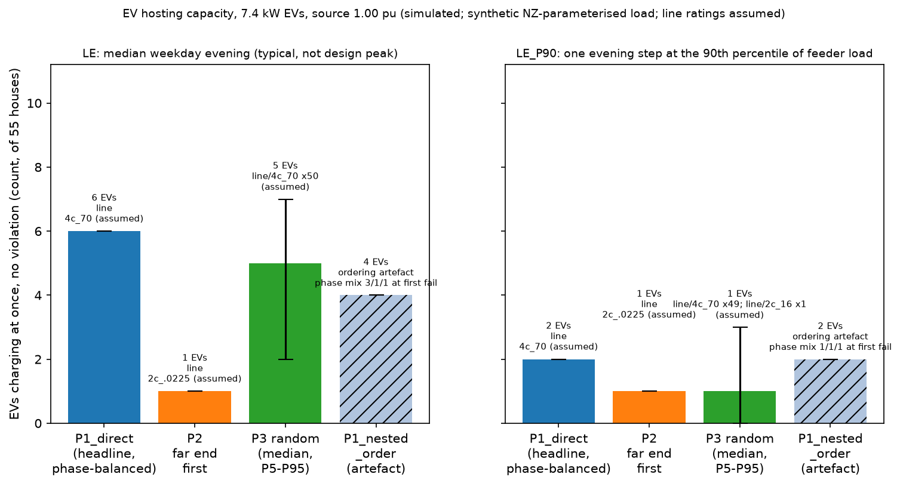
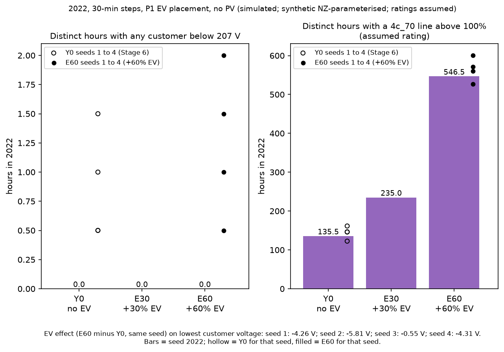

# CP-07: Stage 7, EV hosting capacity (19 Nov 2026)

**Status: built, run, reviewed, fixed.** Everything is **simulated**: IEEE European LV feeder, NZ-parameterised synthetic load and EV sessions, **assumed** cable ratings and an assumed 2% unbalance limit. Nothing is measured.
Sources: `results/stage7_ev_hc.csv`, `results/stage7_year_ev.csv`, `results/stage7_summary.md`, `results/stage7_hand_check.csv`, `results/stage7_voltage_margin.csv`, the recorded pytest run.

## Figures

How many 7.4 kW EVs can charge at the same time on a winter weekday evening before a limit breaks (55 houses). Left: a typical (median) evening. Right: one busy evening (90th percentile of feeder load). [checked: plotted from the CSV]

A full year at 30-minute steps with EVs at 30% and 60% of houses (no PV). Compare each EV case with the no-EV case for the same seed. [checked: plotted from the CSV]

## Done
- **7a, evening snapshot.** Load case LE: each house's median non-EV load on weekday evenings at 19:00 to 20:30 (Jun to Aug 2022, 66 weekdays). EVs of 7.4 kW on one phase each, added one at a time. Placements: P1_direct (balanced across phases), P2 (far end first), P3 (50 random orders). Also LE_P90 (one busy evening), and sensitivities: source voltage, EV power, cable rating, 5 diversity seeds.
- **7b, year 2022 with EVs and no PV.** EV at 30% and 60% of houses (seed 2022), and 60% for seeds 1 to 4, each compared with the same seed without EVs.

## Works (checked)
- **pytest: 70 passed** (the recorded pytest run).
- **Hand check:** 7.4 kW at 230 V is 32.2 A. At the far-end house, predicted voltage drop 7.460 V, OpenDSS 7.462 V (error 0.025%). This checks my loop-impedance model, but it uses the same path resistance as the model code, so it is not fully independent.
- EV modelled as a negative generator equals a constant-power load to within 1 mV. An EV's current shows up on its own phase only.
- Year energy balance (load + EV + losses = transformer energy): error at most 0.00014%. This is a bookkeeping check only.
- **Headline (LE, 7.4 kW, source 1.00 pu, EVs charging at once):**

| Placement | Typical evening LE | Busy evening LE_P90 | Binding limit |
|---|---|---|---|
| P1 balanced | **6** (11% of houses), 2/2/2 per phase | 2 | 4c_70 trunk, phase 1 (LE) / phase 3 (P90) — assumed rating |
| P2 far end first | 1 | 1 | 2c_.0225 cable (assumed rating) |
| P3 random, 50 orders (P5 / P50 / P95) | 2 / 5 / 7 | 0 / 1 / 3 | 4c_70 trunk in nearly all |

- **Voltage never binds.** Lowest customer voltage is 227.6 V with 6 EVs, 221.3 V with 15, 213.5 V with 30, and it only nears 207 V close to all 55 EVs. So the EV limit here is **heat in the cables, not undervoltage**.
- **Sensitivities (P1 balanced):** cable rating ×0.8 gives 3, ×0.9 and ×1.0 give 6, ×1.05 to ×1.2 give 9. Source 0.98 to 1.025 pu gives 6, 1.05 pu gives 9. 3.7 kW EVs give 15. All 5 diversity seeds give 6.
- **Year, EV at 60% of houses (E60):** distinct hours with some line above its assumed rating go from 141.5 (no EV) to 557.5. Peak charging at the same time is 137.9 kW (about 19 EVs). Lowest voltage 208.7 V (seed 2022); for seeds 1 to 4 it is 197.5 to 205.0 V, which is 0.5 to 5.8 V lower than the same seed without EVs and 0.5 to 2 hours below 207 V. E30: 242.5 overload hours, no voltage violation.

## Found, and still open
- **The EV count is a step function of an assumed rating.** On the busiest phase of the trunk, 3 EVs draw about 204 A against an assumed 195 A. A 5% change in that rating moves the answer from 6 to 9. Treat "6" as "about 6, depends on the assumed rating", not as a measured limit. The rating comes from datasheets matched by cable size (R10), not from the network owner.
- **Typical evening is not a design peak.** The busy evening (P90) cuts the count to 2.
- **The first reviewed number was an artefact.** A nested placement list gave 4 EVs (phase mix 3/1/1). The reviewer caught it. The balanced placement gives 6. The nested number is kept in the CSV, labelled.
- **No-EV baseline already overloads** the assumed trunk rating in about 1.6% of the year, so overload hours are best read as the *change* caused by EVs.
- Public holidays count as weekdays in LE (minor).

## Decisions made
- Headline EV result is the balanced placement P1_direct at LE, shown next to the busy-evening case.
- No joint PV × EV map (cut, per the plan).
- No new Y0 year runs: the baselines for seeds 1 to 4 come from Stage 6.

## Next
Commit. Stage 8: mitigation (Australia A volt-var and volt-watt against plain unity power factor, and two tap settings).

