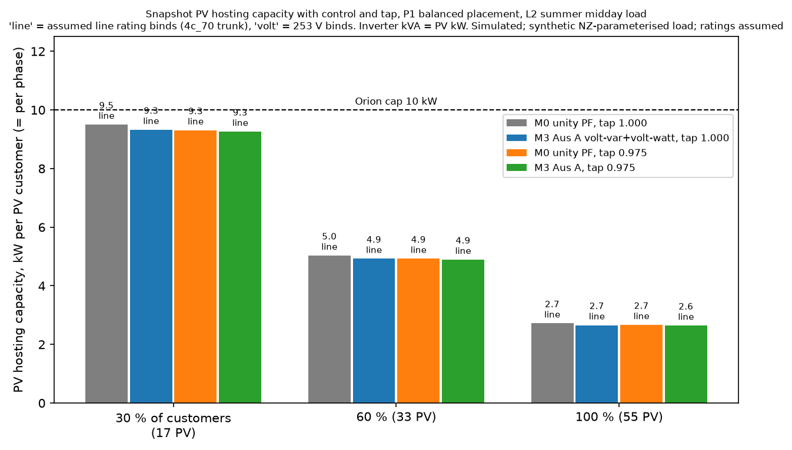
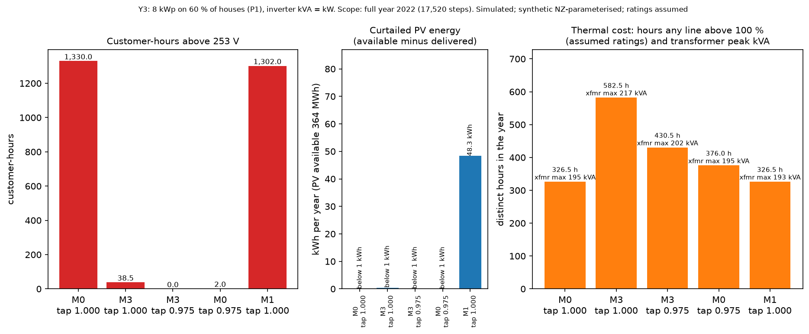

# CP-08: Stage 8, mitigation: inverter control and transformer tap (19 Nov 2026)

**Status: built, run, reviewed, a real bug fixed, re-run.** Everything is **simulated**: IEEE European LV feeder, NZ-parameterised synthetic load, modelled inverters, **assumed** cable ratings. Nothing is measured.
Sources: `results/stage8_hc.csv`, `results/stage8_year.csv`, `results/stage8_ev_tap.csv`, `results/stage8_summary.md` (headline at the top), `results/stage8_hc_run.log`, `results/stage8_year_run.log`, the recorded pytest run.

## Figures

PV hosting capacity per customer for evenly spread PV (P1), with and without Australia A inverter control (M0 vs M3) and with tap 1.000 or 0.975. All four bars are about the same, and the label under each bar says the same thing: the **assumed cable rating** binds, not voltage. [checked: from the CSV]

Year 2022, 8 kWp on 60% of houses. Left: customer-hours above 253 V. Middle: curtailed energy (tiny). Right: the cost, line overload hours and transformer peak. [checked: from the CSV]

## Done
- **Inverter modes:** M0 unity power factor, M1 volt-watt only, M2 volt-var only, M3 Australia A volt-var + volt-watt (curves in per-unit of 230 V). **Tap:** 1.000 and 0.975 (secondary 2.5% lower).
- **8a snapshot:** 1,272 hosting-capacity rows (P1, P2, P3 with 50 seeds, 30/60/100%, all modes, both taps, plus an inverter-size sensitivity).
- **8b year (Y3):** M0, M1, M3, M3 + tap, M0 + tap, M3 with 10% spare inverter size.
- **EV and tap:** the EV evening case at both taps.

## Works (checked)
- **pytest: 98 passed** (the recorded pytest run).
- **Hand checks (as tests):** volt-var reactive power at 1.0826 pu is −0.30 of rating (−1.5 kvar for 5 kVA), matching the curve; volt-watt gives 20% output at 260 V; tap 0.975 gives no-load 234.17 V against 234.18 V by hand; M0 built with the new inverter objects reproduces Stage 6 exactly.
- **Year energy balance with curtailment:** error at most 0.003% of transformer energy (bookkeeping check only).
- **Results (Y3, 8 kWp, 60% of houses, full year 2022):**

| Case | Customer-hours above 253 V | Curtailed energy | Distinct hours any line above 100% | Transformer peak |
|---|---|---|---|---|
| M0 no control | 1,330 | 0 | 326.5 | 195.1 kVA |
| M1 volt-watt only | 1,302 | 48.3 kWh | 326.5 | 192.8 kVA |
| M3 Australia A | 38.5 | below 1 kWh | 582.5 | 216.6 kVA |
| M3 + tap 0.975 | 0 (2 customer-hours below 207 V) | below 1 kWh | 430.5 | 202.3 kVA |
| M0 + tap 0.975 | 2.0 (4.5 customer-hours below 207 V) | 0 | 376.0 | 194.6 kVA |

- **Snapshot headline (P1, tap 1.000):** M0 9.5 / 5.0 / 2.7 kW and M3 9.3 / 4.9 / 2.7 kW at 30 / 60 / 100%. Control does **not** raise it, because the assumed 4c_70 trunk rating binds and the reactive power adds current.
- **Voltage-only hosting capacity (cable rating ignored, P1, 60%):** M0 6.0 kW, M3 7.5 kW, M3 with tap 0.975 10.2 kW. So control and tap do free up voltage room. The cable rating is what stops us using it.
- **Tap on the voltage-limited placement P2:** 5.4 to 7.5 kW at 30% and 4.0 to 4.6 kW at 60%.
- **Tap on EVs:** lowest customer voltage with no EV 233.3 V to 227.1 V; with 30 EVs 213.5 V to 206.7 V (one voltage violation). The EV count stays 6, so it only costs margin.

## Bugs found and fixed (the review worked)
- **Inverter memory.** OpenDSS inverter control remembers where it stopped, so each search step started from the previous step's state. 730 of 1,272 values moved (largest change 1.07 kW). Fixed with a cold start before every point, and a test that the same point gives the same voltages after any history.
- **Hidden reactive power.** Houses without PV still had a zero-output inverter absorbing reactive power. Fixed in the snapshot and in the year runs.
- **Wrong inverter size** (first run): a setter did not update the reactive limit. Fixed and tested.
- The PV peak is 0.89 kW per kWp, not 0.78 as first written. Spare inverter size at peak is only about 0.45 of rating.

## Found, and still open
- **The cost of control is thermal.** Reactive power loads the trunk: line overload hours 326.5 → 582.5 and transformer peak 195 → 217 kVA (assumed ratings). Whether that matters depends on the real ratings.
- **Var priority is an assumption.** OpenDSS cuts real power first to make room for reactive power. No source says Australia A requires this.
- **Hosting capacity is accurate to about ±0.1 kW** (the control settles only to a tolerance), so tables show 0.1 kW.
- Tap 0.975 slightly *raises* low-voltage risk: 2 to 4.5 customer-hours below 207 V in the year.

## Decisions made
- Headline is "control and tap fix voltage but not the thermal limit" — not a larger hosting-capacity number.
- Inverter kVA = PV kW in the snapshot (no spare), as the base case; 10% spare is a sensitivity (it gave a *lower* hosting capacity in all 24 cases, believed to be from reactive-power priority; not tested).
- No battery, per the plan.

## Next
Commit. Stage 9: validation table, limitations, assumptions with bias direction, and a clean-clone run.

