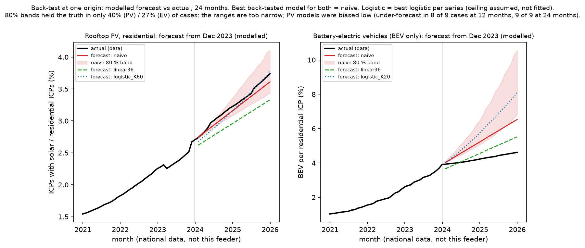
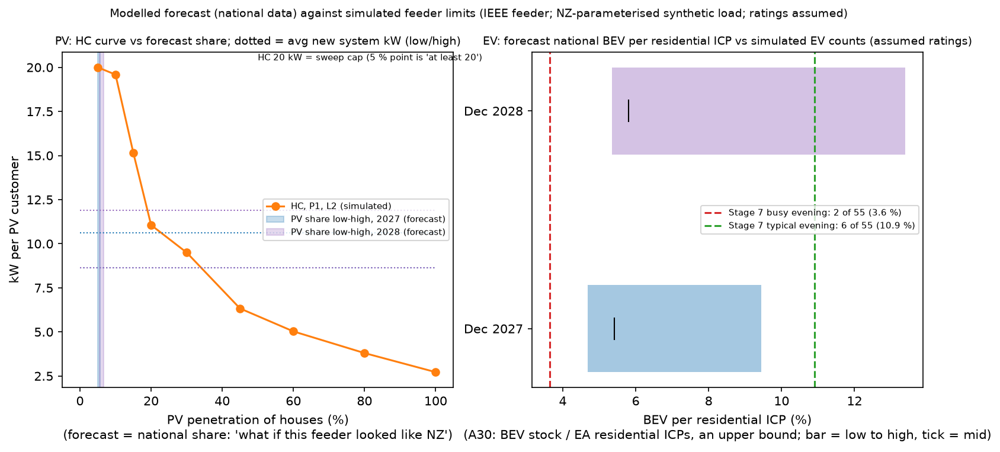

# CP-09b: Stage 9b, uptake scenarios for 2027 and 2028 (19 Nov 2026)

**Status: built, reviewed, fixed.** This is a **modelled forecast from national data**, not a measurement, and not a prediction for this feeder. Hosting-capacity limits next to it are **simulated** with assumed cable ratings.
Sources: `research/R11-uptake-data.md`, `results/stage9b_summary.md` (headline at the top), `results/stage9b_backtest.csv`, `results/stage9b_scenarios.csv`, `results/stage9b_hc_curve.csv`, `results/stage9b_hc_n_direct.csv`, the recorded pytest run.

## Figures

Forecasts against what really happened, for rooftop solar and EVs, with the simple "last year's trend" model next to the best S-curve model. The 80% bands are too narrow and say so in the title. [checked: from the CSV]

Left: the simulated PV hosting capacity per customer, with the forecast national share of homes with solar (the thin bands) and the average new system size (dotted). Right: forecast EVs per residential connection for Dec 2027 and Dec 2028 (bar = low to high, tick = middle) against the Stage 7 simulated EV limits. [checked: from the CSV]

## Done
- **Data (R11):** 159 monthly points of residential solar connections (Electricity Authority, to Oct 2026) and 122 monthly points of battery-EV stock (Ministry of Transport via Figure.NZ, to Feb 2026). Drivers: CPI, population, GDP; the electricity price series is stale (ends 2025 Q1).
- **Models:** naive (last value plus last year's change), linear trend, damped trend, S-curve with assumed ceilings, and driver regression.
- **Back-test:** rolling origins at Dec 2021, Dec 2022 and Dec 2023, forecasting 12 and 24 months ahead, with release lags for drivers.
- **Scenarios and link:** low / mid / high for Dec 2027 and Dec 2028, read against the feeder's simulated limits.

## Works (checked)
- **pytest: 128 passed** in the full suite at the time (the recorded pytest run).
- The reviewer re-computed one naive forecast by hand (PV, Dec 2023, 12 months: error −0.069 percentage points) and it matched the file. Leakage controls (driver release lags, gap in cross-validation, forecast horizons that stay inside the data) were checked.
- **Did the non-linear model or the drivers make a difference? No.** Mean absolute error, in percentage points of share, over the three origins:

| Series | Naive | Linear 36 months | Damped trend | Best S-curve | Driver regression |
|---|---|---|---|---|---|
| Rooftop PV | **0.13** | 0.37 | 0.21 | 0.15 | 0.37 |
| EV | **0.92** | 1.01 | 0.99 | 1.32 | 1.48 |

  The S-curve beat the 36-month straight line for PV, but the naive forecast beat every S-curve. Drivers did not help either series. With three origins, differences of a few tenths of a point mean little.
- **Scenarios (low / mid / high):**

| | Dec 2027 | Dec 2028 |
|---|---|---|
| PV share of houses (4.3% now) | 5.0 / 5.1 / 5.6% | 5.5 / 5.8 / 6.7% |
| Average new PV system (8.6 kW now) | 8.6 / 9.0 / 10.6 kW | 8.6 / 9.1 / 11.9 kW |
| BEV per residential connection (4.7% now) | 4.7 / 5.4 / 9.4% | 5.4 / 5.8 / 13.4% |

- **Feeder reading ("what if this feeder looked like NZ"):** with 3 PV houses out of 55 the hosting capacity is at least 20 kW; with 4 it is 18.5 kW. The average new system (8.6 to 11.9 kW) is below that in every scenario. A 9 kW system would first exceed the limit at roughly 32 to 34% of houses, about five times the national share forecast. The EV forecast is different: the middle case lies between the busy-evening limit (2 of 55, 3.6%) and the typical-evening limit (6 of 55, 10.9%), and the high 2028 case is above both.

## Found by the review, and fixed
- **The low EV case was below the level already reached.** Stock never fell in any of 122 months. All scenarios are now floored at the last observed share.
- **"EVs per household" was a mislabel.** The measure is battery EVs per residential connection (data), and is an **upper bound** on homes with an EV. A guessed persons-per-household figure no longer drives it.
- **The narrow bands were hidden in the body.** They are now in the headline and in the figure title: the 80% bands held the truth only 40% (PV) and 27% (EV) of the time, and PV models were biased low.
- The hosting-capacity reading used straight-line interpolation that gave about 19.9 kW at 4 houses; a direct simulation gives 18.5 kW. Direct runs are used now, and the summary says the curve is not smooth in house count.

## Still open
- The EV forecast probably underestimates: a third-party snippet (not data) puts the Oct 2026 level at about 5.5%, above the 2027 middle case (5.4%). The models miss the 2026 rebound. Ministry of Transport Mar to Oct 2026 data needs a manual download.
- Back-test has only three origins and no origin after 2023, so it cannot rank the models firmly.
- Ceilings for the S-curve are assumptions with no source. Whole-house solar size against a single-phase limit is a rough comparison.
- National shares are not this feeder. This is a what-if, not a forecast for it.

## Decisions made
- Report the answer plainly: for this data and horizon, extra modelling did not beat the simple trend. Keep scenarios wide and call them scenarios.
- Drivers (population, inflation, price) are kept in the report as tested and not helpful, with no causal claims.

## Next
Stage 10 dashboard review fixes, then Stage 11 (README and release).

